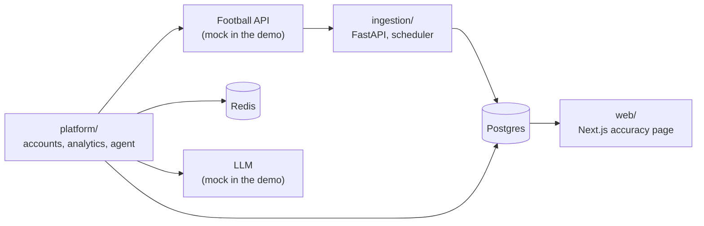

# Football intelligence platform

Backend, data pipeline and AI agent prototype for a football analytics product: collecting match data, measuring the accuracy of predictions and answering questions in natural language.

[](https://github.com/firechair/football-intelligence-platform/actions/workflows/ci.yml)

## Demo

84 seconds, recorded from a clean clone: the stack starts, data is collected and the predictions are scored, the accuracy page fills in, the agent answers a question, and the Go receiver's tests run. Terminal output is real, replayed and sped up.

https://github.com/user-attachments/assets/b853abcf-0c8b-4a92-83e4-d6ad057133e1

## What it did

The product collected fixtures, predictions and odds compared across bookmakers, then measured how often those predictions came true. Users could ask about the data through an AI assistant.

It was an MVP, stopped before launch. See [Project status](#project-status) for what worked and what did not.

## Architecture



More detail in [docs/ARCHITECTURE.md](docs/ARCHITECTURE.md).

## Run it

You need Docker. No API keys: the football API and the LLM are replaced by local mocks, and all data is synthetic.

```bash
docker compose up -d --build --wait

# Collect data, finish today's matches and score the predictions (about 30 seconds)
docker compose run --rm ingestion python scripts/collect_once.py --simulate-results

# Ask the agent a question: it prints the tools it called, then the answer
docker compose run --rm platform python scripts/ask_agent.py "What are the odds for Inter vs Milan?"
```

Then open:
- http://localhost:3000/accuracy for the accuracy page;
- http://localhost:8000/docs for the accounts and analytics API;
- http://localhost:8001/docs for the data API.

To stop and delete everything, run `docker compose down -v`.

To use a real LLM, copy `.env.example` to `.env` and fill it in.

### Tests

```bash
cd ingestion && pytest -q                                      # 24 tests
docker compose run --rm ingestion pytest -m integration -q     # 3 tests against Postgres and the mock API
cd platform && pytest -q --no-cov                              # 145 tests
cd demo && pytest -q                                           # 15 tests
cd web && npx vitest run                                       # 16 tests
cd prototypes/odds-receiver && go test -race ./...             # 25 tests
```

## What each module shows

| Module | Where | What to look at |
|---|---|---|
| API client with rate limiting | `ingestion/app/utils/football_api.py` | Concurrency limit, atomic request spacing, per-endpoint statistics. No retry after a 429. |
| Scheduler and collectors | `ingestion/app/core/scheduler.py`, `ingestion/app/services/` | Separate jobs for fixtures, predictions, odds and results. |
| Accuracy evaluation | `ingestion/app/services/accuracy_evaluator.py` | Scores provider predictions against results. |
| Accuracy page | `web/src/app/accuracy/` | Next.js page with a typed adapter over the API. |
| Accounts and security | `platform/app/api/users.py`, `platform/app/services/` | JWT, TOTP 2FA, sessions, password recovery, rate limiting. |
| Intent detection | `platform/app/services/intent_detection.py` | Rule-based classification of Italian questions. |
| Odds movements and rankings | `platform/app/services/alert_engine.py`, `bookmaker_analytics.py` | Movement detection and a weighted bookmaker score. |
| Compliance | `platform/app/services/compliance_service.py` | Keyword screening of messages and replies, with help resources. |
| Agent (**prototype**) | `platform/app/services/function_calling_orchestrator.py` | Function-calling loop with four tools and a limit of five iterations. |
| Push receiver (**prototype**, 2025) | `prototypes/odds-receiver/` | Go rewrite of a provider's PHP receiver: acknowledges at once, saves to disk, processes in goroutines, queues writes, and holds offers that arrive before their outcome. |

## Project status

It was an MVP, stopped before launch.

| Part | Status |
|---|---|
| Data collection, accuracy evaluation | Working, after the fixes listed below |
| Accounts and security | Working, after the fixes listed below |
| Frontend | Partial. It had about 20 pages, some with placeholder data. Only the accuracy page is published here. |
| AI chat | Unreliable. Intent detection plus an LLM was the path connected to the interface, and the Parlant framework caused timeouts and truncated answers. Not published here. |
| Function-calling agent | Prototype, never connected to the interface. Here it runs from a script. |
| Go push receiver | Prototype from March 2025; its last version was never committed. Fixed and tested in 2026. The history does not record whether it ran against the live feed. |
| Value bet detection, personalized suggestions, proprietary LLM | Not implemented. The stubs were removed, and the product used hosted models through OpenRouter. |

**Predictions come from the data provider, not from a proprietary model.** The accuracy page measures the provider's predictions.

Known limits are listed in [docs/ARCHITECTURE.md](docs/ARCHITECTURE.md#known-limits).

## Problems I worked through

- **Live odds in Streamlit:** every attempt is still in the code, and the limits of Streamlit led to separate services for collection and display.
- **Providers that push and providers you poll:** a Go receiver for an XML push feed, scheduled clients for REST APIs.
- **Concurrency against provider limits:** concurrency limits, request spacing and a scheduler.
- **The same data from different sources:** team names, market codes, schemas.

The details, with links to the code: [docs/CHALLENGES.md](docs/CHALLENGES.md).

## What the cleanup found

The project stopped in January 2026. Reopening it in 2026 and making the code run from a clean clone, with tests, exposed bugs that the original project never caught. Each one has its own `fix:` commit with the explanation. The main ones:

- **2FA could not work.** The secret was never saved and every code was rejected.
- **Saving a profile always failed**, and refreshing a token depended on a library missing from the requirements.
- **Accuracy results were always empty on a migrated database.** One route read fields that do not exist, and a timestamp was never set.
- **Under/over predictions could never score as correct.** The code compared them with the words "under" and "over", while the provider's documentation shows values like `-3.5`.
- **Bookmaker rankings always failed** on real data, and the cache did nothing once Redis was connected.
- **The compliance filter made harmful replies worse**, and a message about suicide received only gambling numbers.
- **Concurrent API requests started in bursts**, past the provider's limit.
- **The accuracy page stayed at zero** if opened before any data arrived, because the web server kept its first answer. Only watching the page in a browser showed it: the API checks passed.
- **The Go receiver lost data.** Files received in the same millisecond overwrote each other, and its autosave raced with incoming pushes.

The 81 account tests inherited from the project had also gone stale: 32 of them failed or errored on the first run. Their expectations now state what the code does on purpose, and the other 64 platform tests are new.

The complete list, part by part, with how far each part had got: [docs/REOPENING.md](docs/REOPENING.md).

## Evolution

From prototypes in Streamlit, Flask and Go to the services here: [docs/EVOLUTION.md](docs/EVOLUTION.md). Working notes from the time are in [docs/history/](docs/history/).

## About this repository

*Extracted from a private startup codebase I built (2024–2026). History filtered for publication: product name, bookmaker names and credentials redacted, unrelated modules removed. Code that was never committed is imported as snapshot commits: author date = last change to the files, committer date = import. Commits after the `history-import` tag are the 2026 cleanup.*

Bookmaker names such as "Bookmaker A" and the name "FIP" are placeholders from that redaction, and hosts appear as `example.invalid`.

## License

None. The code is published to show my work: you may read it, but not copy, modify or reuse it without permission.
