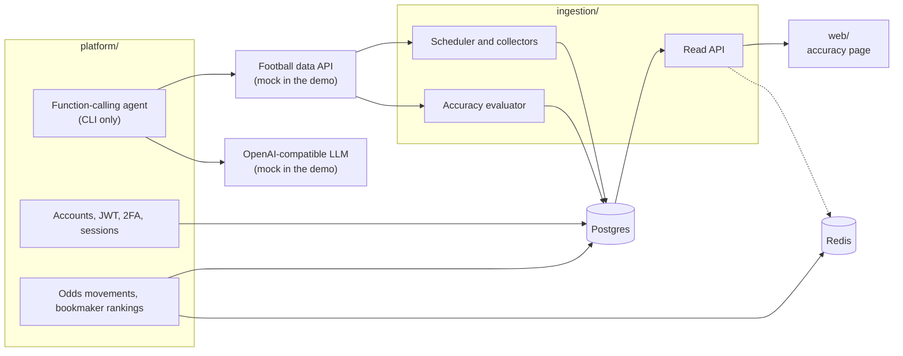

# Architecture

## Components

**`ingestion/`** collects fixtures, provider predictions and odds, then scores those predictions against results.
- A single client (`app/utils/football_api.py`) applies a limit of five concurrent requests and a minimum gap between requests, and keeps per-endpoint statistics. It does not retry after a 429.
- The scheduler (`app/core/scheduler.py`) runs fixtures and predictions every 6 hours, odds every 3 hours and result checks every 30 minutes.
- `scripts/collect_once.py` runs one cycle and exits, so the demo does not wait for those timers.

**`platform/`** holds accounts and security, odds analytics, and the agent.
- Accounts: JWT access and refresh tokens, sessions, TOTP two-factor authentication, password recovery, rate limiting.
- Analytics: odds movement detection and bookmaker rankings, served under `/api/v2`.
- Agent: `app/services/function_calling_orchestrator.py` loops between the model and four tools, stopping after five iterations.
- `scripts/ask_agent.py` runs the agent from the command line, between the compliance check and the response filter.

**`web/`** is one Next.js page showing predictions against results. Its API routes call `ingestion`.

**`demo/`** replaces external services:
- `mock_football_api` has the same response shape as the real API, synthetic values and a 429 limit. `POST /__finish-today` acts as a simulated clock, so predictions collected before kickoff can be scored.
- `mock_llm` picks a tool by keyword, which is enough to drive the agent loop.

## Data flow in the demo

1. `collect_once.py` fetches today's fixtures, predictions and odds through the rate-limited client.
2. With `--simulate-results`, the mock finishes today's matches.
3. The evaluator stores each result and scores the winner, under/over and win-or-draw predictions.
4. The page reads the summary and the per-match results from `ingestion`.

## Technical choices

- **Mocks at the HTTP boundary.** The real clients run unchanged; only a base URL differs.
- **A global lock around request spacing.** The check, the wait and the update must be atomic, or concurrent callers start together. A test measures actual start times.
- **Synthetic data computed from today's date**, so the demo keeps working on any day.
- **No host ports for Postgres and Redis**, so a busy local port does not stop the demo.

## Known limits

These are left as they were, because fixing them would mean building new features:

- `ingestion` has no authentication. It was meant as an internal service, and it still has an open `POST /api/v1/assets/logo/clear-cache` and a wildcard CORS policy. Do not expose it publicly.
- Predictions come from the data provider. The accuracy page measures the provider, not a model of ours.
- Intent detection is rule-based: hundreds of regular expressions that are easy to break with a rephrased question.
- Compliance screening uses keywords and keeps risk scores in memory, so it is a safeguard, not a clinical tool. It covers only the agent path.
- The evaluator reads `-3.5` as under 3.5 goals and `+2.5` as over 2.5. The provider's documentation shows the format but does not define the sign, so this reading is an assumption. It was never checked against live data.
- Alerts have to be triggered; no background job runs them.
- Bookmaker statistics are only updated when odds pass through the cache, and nothing in the demo does that automatically, so rankings start empty.
- The agent's tools use RapidAPI headers while `ingestion` uses the provider's own, so both would need a matching key in production.
- `platform/` creates its tables from the models. Seven of its eight migrations replay on a clean database. The last one was autogenerated against a database shared with `ingestion`, drops tables it does not own, and is kept only as history.
